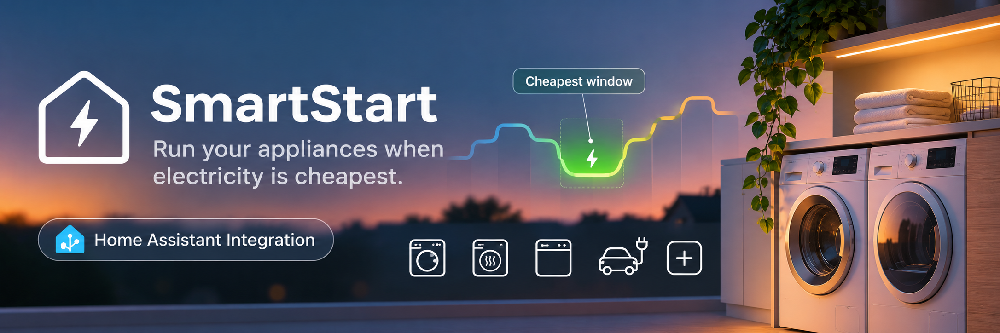

# SmartStart

**Run your appliances when electricity is cheapest.** SmartStart is a [Home Assistant](https://www.home-assistant.io/)
custom integration that schedules your dishwasher, washing machine, dryer, EV charger or anything else Home Assistant
can start around **dynamic energy pricing**: Octopus Agile and similar time-of-use tariffs, or any rate data you feed it.

> [!WARNING]
> **Beta software.** SmartStart is under active development: settings, entities and behaviour can change between
> releases, and it has not been tested across many homes, tariffs or appliances. It starts real appliances. Try it
> on one device first, and keep an eye on what it schedules.

> [!NOTE]
> **Built with AI assistance.** Much of this project was written with [Claude](https://claude.com/claude-code), an AI
> coding assistant. It runs in its author's own home, but treat it like any young open-source project: read what it
> does before you trust it, and report anything odd.

---

## Installation

SmartStart is installed from Home Assistant's Marketplace as a custom repository.

1. In Home Assistant open **Settings → Marketplace**
2. Go to **Integrations** → menu (⋮) → **Custom repositories**
3. Add `https://github.com/alexw23/smartstart` with category **Integration**
4. Search for **SmartStart** and click **Download**
5. Restart Home Assistant

The button above opens the repository in your Home Assistant. If you still use HACS, the steps are the same.

**Manual install:** copy the `custom_components/smartstart` directory into your Home Assistant
`custom_components/` folder and restart.

## Setup

Or go to **Settings → Devices & Services → Add Integration** and search for **SmartStart**.

The setup wizard walks you through:

1. **Rate provider** — Octopus Energy (auto-detected if present) or Manual
2. **Currency / rate unit** — e.g. `£` / `p`
3. **Device** — appliance name, the HA service to call to start it, optional cancel service
4. **Cycle(s)** — duration and energy consumption of each programme

You can add multiple devices and multiple cycles per device via **Settings → Devices & Services → SmartStart → Configure**. Every setting is described in the
[configuration reference](docs/configuration.md).

## What it does

- **Finds the cheapest window.** Give it a cycle's duration and energy use and it picks the cheapest contiguous slot
  inside your limits, then starts the appliance then, using the appliance's own delayed start or a timer SmartStart
  manages itself. Optional **Finish by** deadlines, a **Start now** override, and three modes: *Max Savings*,
  *Balanced* (soonest acceptable window) and *Now*.
- **Understands your tariff.** Octopus Energy rates are picked up automatically (see [Rate providers](docs/rate-providers.md));
  anything else can be pushed in with the `smartstart.publish_rates` service, and forecasts with
  `smartstart.publish_predicted_rates`. When new rates land, scheduled runs can move to a cheaper window by themselves,
  or near the daily release SmartStart can hold for tomorrow's prices.
- **Negative prices and solar.** Rates are just numbers per slot, so negative prices naturally become the best
  windows, and forecast negative prices can be published ahead of time. SmartStart has no solar integration of its own,
  but you can use the same service to publish a rate curve where sunny, surplus-solar slots are cheap (or negative)
  and it will pull cycles into them.
- **Keeps out of power-downs.** Octopus Octoplus power-down events and saving sessions are discovered automatically
  (any calendar entity works), and each appliance chooses to *Avoid* them or *Ignore* them. See
  [Power-down windows](docs/power-down.md).
- **Plans your laundry.** A [laundry pair](docs/laundry.md) schedules wash then dry as one plan: it
  orders your loads to cost the least, waits for changeovers around your sleep and away times, and splits the plan
  around power-downs. Define **flows** (e.g. "Bed linen" = a wash plus a dry), set them to repeat every N days, and it
  fills your plan when one is due. It records how often you *actually* run each flow and shows that against the
  configured interval, so you can see whether your routine matches your plan and how often you can realistically run
  the machines.
- **Offers cheaper options.** If a much cheaper window exists that the current schedule can't reach (a forecast slot,
  or past the appliance's own delay limit) you get a one-tap offer.
- **Learns your appliances.** With an optional power sensor it learns each cycle's real duration and power curve,
  and records runs, cost and savings.
- **A sidebar panel** with rate charts, recommended windows, run history, cycle statistics and the laundry planner.

## Good to know

**Sleep windows are for laundry only.** A laundry pair never plans a changeover while you're asleep (default
23:00-07:00, configurable per pair). Single appliances ignore it: a dishwasher can run at 3 a.m. because it needs
nobody there.

**Power monitoring is optional.** A power sensor lets SmartStart learn real cycle durations and curves, but everything
works without one using the duration and kWh you enter. SmartStart only *reads* the sensor; it never switches
power to an appliance. It only calls the start (and optional cancel) service you configure.

> [!CAUTION]
> **Adding power monitoring to an appliance carries risk, and managing that risk is your responsibility.** Fitting a
> smart plug or inline meter adds a connection and, usually, a relay in the appliance's supply. Washing machines, dryers
> and dishwashers draw a lot of current: use a device rated well above the appliance's maximum load, and prefer
> **relay-free** monitoring (a clip-on CT clamp or a measurement-only meter) where you can. Do not use a relay to
> switch an appliance off while it is running. SmartStart does not need you to, and does not do it for you. If you
> are not sure, skip the power sensor.

---

## Documentation

| | |
|---|---|
| [Configuration reference](docs/configuration.md) | Every device and cycle setting |
| [Rate providers](docs/rate-providers.md) | Octopus discovery, any other tariff, negative prices and solar |
| [Power-down windows](docs/power-down.md) | Keeping cycles out of Octopus power-downs and saving sessions |
| [Laundry pair](docs/laundry.md) | Wash → dry plans, flows, load order, sleep and away times |
| [Sidebar panel](docs/panel.md) | The SmartStart panel, run history and tagging |
| [Buttons, services and automations](docs/services.md) | `smartstart.start`, `publish_rates`, example automations |
| [Sensors](docs/sensors.md) | Schedule and rate sensors, Best Windows, Offers |
| [Delay modes](docs/delay-modes.md) | Native delay versus SmartStart-managed timers |

## Contributing

Pull requests are welcome. Please open an issue first for significant changes. SmartStart is beta software, so bug
reports with your tariff/provider, appliance type and the relevant Home Assistant log lines are especially useful.

## Licence

Copyright (C) 2026 alexw23

SmartStart is free software, licensed under the [GNU General Public License v3.0](LICENSE). You may use, study,
modify and share it, but anyone who distributes a modified version must release it under the same licence, with
source. It comes with no warranty. Contributions are accepted under the same licence.
